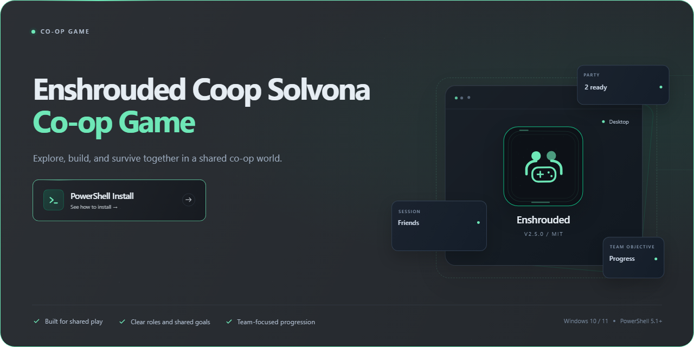

# Enshrouded Coop Solvona: Play Together

### 🖥️ PowerShell Setup

   

<h3>Support this project</h3>

<strong>ETH</strong>:&nbsp;<code>0xB33F5310CE5A1641058b6c9b28D3293850954885</code>

---

Enshrouded Coop Solvona is built for players who want to explore, build, and survive together in a shared world where cooperation shapes every session. Gather resources as a team, divide crafting and base-building tasks, and push into dangerous territory with someone watching your back. The experience is designed around concrete shared play: pooling materials, planning routes, and coordinating fights rather than splitting off alone. Whether you are settling a new base or venturing into the shroud, the game rewards players who communicate and plan as a group.

## 🔧 Requirements

- Windows 10 or Windows 11
- PowerShell 5.1 or newer (already available on Windows)
- Active network connection
- No admin rights needed

## How to Start

Getting your group into enshrouded-coop-solvona is refreshingly simple, so gather your friends and agree on who will send the invitations before anyone launches anything. A quick conversation about who invites whom saves confusion later and keeps the whole process smooth.

First, open Steam and keep it running in the background. Steam needs to stay active the entire time, so leave it open rather than closing it after signing in.

Next, launch the game while Steam is open. With Steam already running, the game will start up and connect through it without any extra steps on your part.

Once the game is running, your active session will appear in Steam as "Spacewar". To play together, either wait for a friend's invitation and accept it when it arrives, or invite your friends yourself so they can join your session. Both directions work equally well, so the choice is simply about who sends the invite.

That is all there is to it. With Steam open, the game launched, and everyone clear on invitations, your group can be playing together in just a few moments.

## Features

- Built for shared play from the start: the experience is shaped around playing together rather than treating cooperation as an extra.
- Clear roles and shared goals: sessions give players reasons to coordinate, divide tasks, and help each other rather than quietly playing separate games.
- Team-focused progression: meaningful progress is tied to what the group accomplishes together, so helping the team also moves you forward.
- Readable cooperative state: important shared information is presented so everyone can see what the group is doing and what still needs attention.
- Pick-up-friendly sessions: the flow is designed so players can join in, contribute, and feel useful without needing to know every detail beforehand.
- Encourages communication: objectives and shared situations are structured to prompt real coordination, not just parallel play.
- Replayable group play: sessions are meant to be revisited with different approaches and different team compositions, keeping cooperation fresh.

## How It Works

Enshrouded Coop Solvona is built around the idea that a shared session should feel like one continuous adventure rather than a series of disconnected check-ins. When you start a co-op game, the world you explore is the same world your teammates explore: progress, discoveries, and changes to the environment persist for everyone in that session. You and your fellow players move through the same spaces, face the same threats, and benefit from the same victories.

The shared gameplay loop is straightforward. Players gather resources, craft and improve gear, build and defend bases, and push into new areas together. What one player clears or secures contributes to the group's momentum, so coordination matters more than individual speed. The game rewards players who communicate about who is scouting, who is gathering, and who is holding ground, because those roles overlap and shift as the session evolves.

Enshrouded Coop Solvona is intended to be played as a team. Encounters and exploration are designed so that splitting up is a real choice with real tradeoffs: someone might range ahead to map a route while others reinforce a base or stockpile materials. The session supports this kind of division of labor without forcing everyone into the same activity at the same time, and it keeps the group's shared state consistent so no one is left behind on a separate copy of the world.

Joining a session is meant to be a low-friction, player-driven process: one player hosts, others join that hosted world, and everyone plays within the same persistent environment for the duration of the session. There is no separate progression track for co-op; the group shares the consequences of its actions, from structural damage to opened routes. That shared consequence is the core of the experience — decisions made together stick, and the world reflects the team's combined effort.

The intended feel is collaborative problem-solving under pressure: dividing attention, covering each other, and returning to base with something to show for it. Enshrouded Coop Solvona works best when players treat the session as a joint project, plan a little before heading out, and stay aware of what the rest of the team is doing. The game provides the shared world and the persistent state; the coordination, role-swapping, and teamwork come from the players.

## Modules and Settings

### Shared Session Overview

Collects live co-op details into one view so the whole group works from the same picture, which serves as the central hub the other modules feed into.

- Choose which session details are shown to the group, such as highlighting pending objectives or recently finished ones, so the overview reflects what the team cares about most.
- Adjust visibility of member presence information to keep the roster readable during larger sessions.
- Pin priority items to the top of the overview so urgent objectives stay noticeable.

### Role and Task Assignment

Lets the group divide labor by assigning duties to individual members and keeping those assignments visible to everyone.

- Assign, reassign, or clear roles and tasks per member as the session evolves.
- Attach optional notes to each assignment so context travels with the task.
- Highlight unassigned duties so no job silently falls through.

### Resource and Inventory Tracking

Records shared stockpiles and contributions so the team knows what it has before committing to a build or expedition.

- Adjust which resource categories are tracked to match the group's priorities.
- Note contributors alongside recorded stockpiles to keep shared accounting transparent.
- Flag low or depleted categories so the group can plan gathering runs before starting large projects.

### Objective and Progress Logging

Maintains a living list of group objectives whose state feeds both the overview and the coordination prompts.

- Log objectives and mark progress as the team advances.
- Reorder objectives or split them into smaller steps as plans change.
- Archive finished objectives so the active list stays focused.

### Session Planning and Preparation

Combines upcoming activity plans with per-character preparation notes so sessions start without lengthy setup discussion.

- Record intended activities for upcoming sessions and note confirmed attendance.
- Store preparation notes per character, such as gear intentions or consumables to bring.
- Keep recurring notes as standing reference points or edit them per session.

### Coordination Prompts and History Review

Surfaces reminders for unresolved items during play and produces a session summary afterward, closing the loop between active coordination and the next session.

- Adjust which prompts are surfaced and how often they appear, drawing from pending assignments and objectives.
- Review an end-of-session summary of completed objectives, assignments, and logged progress.
- Adjust what the history captures so future summaries stay relevant.

### Additional Settings

- Overview emphasis: control whether the shared view leans toward pending work or recent completions.
- Prompt frequency: tune how often coordination reminders appear during busy moments.
- History scope: choose which categories of activity are retained in session summaries.
- Planning detail: set how much availability and activity information is shown to the group.
- Preparation visibility: decide whether personal preparation notes are shared with everyone or kept private.

## Usage Scenarios

### Organizing a Weekend Co-op Session

**Goal:** A small group planning a Saturday Enshrouded run wants everyone to arrive knowing their job, so the session starts without lengthy setup discussion.

**Steps:**
1. Record the intended activities for the upcoming session, such as a building push and a resource run, and note which members have confirmed attendance.
2. Assign roles and tasks per member — gathering, building, and exploration duties — attaching short notes with context for each.
3. Review the shared session overview to check the roster and pin the most urgent objective to the top so it stays noticeable.
4. Adjust planning detail so the group sees enough availability information without cluttering the view.
5. Have each member store preparation notes for their character, such as gear intentions or consumables to bring, shared with the group.

**Expected result:** Each participant opens the overview before joining and sees their assignment, the confirmed plan, and a personal preparation note to review — the group starts playing without renegotiating who does what.

### Running a Build Project Without Resource Guesswork

**Goal:** Before committing to a large base build, the team wants an up-to-date picture of shared stockpiles and who contributed what.

**Steps:**
1. Adjust the tracked resource categories to match the materials the build actually needs.
2. Record current stockpiles and note contributors alongside each entry to keep shared accounting transparent.
3. Flag low or depleted categories so the group can plan gathering runs before starting.
4. Assign gathering duties to specific members and highlight any unassigned duties so nothing falls through.
5. Log the build itself as an objective with smaller steps, marking progress as materials arrive.

**Expected result:** The overview shows an up-to-date summary of available materials, flagged shortages, and a progress list of build steps — the team commits to the project knowing exactly what is missing and who is gathering it.

### Wrapping Up and Resuming Next Time

**Goal:** After a busy session, the group wants a lightweight record so the next run picks up where it left off, and wants fewer missed handoffs during play.

**Steps:**
1. During the session, tune prompt frequency so reminders about pending assignments and upcoming objectives surface at a comfortable pace.
2. Adjust overview emphasis toward pending work so unfinished items stay in front of the group.
3. Mark completed objectives and archive finished ones so the active list stays focused.
4. After the session ends, review the end-of-session summary of completed objectives, assignments, and logged progress.
5. Adjust history scope to choose which activity categories are retained for future summaries.

**Expected result:** The team closes with a summary of what was completed and what remains, and at the start of the next session the overview and prompts point directly at the unfinished objectives and reassignable duties — no one has to reconstruct the previous run from memory.

## Co-op Sessions

Co-op Sessions are built around playing together from the start: gather a group, share a world, and take on the same challenges side by side. The intended shared gameplay is straightforward—everyone explores, builds, and fights as one team, with progress and discoveries belonging to the session rather than to a single player.

When you launch a Co-op Session, you and your fellow players work through the same world together. Coordination matters more than solo speed: splitting up to scout, regroup to defend, and pooling resources for shared goals are all part of the flow. Sessions are meant to be resumed with the same group, so the world you shape together stays the world you return to.

Use Co-op Sessions when you want the full cooperative experience—shared exploration, shared building, and shared combat—rather than a single-player run. The focus is on the group's collective progress and the moments that come from playing in the same session, not on any particular matchmaking or hosting setup.

## Team Play

Team play in Enshrouded Coop Solvona is built around shared goals and open communication. Before setting out, agree on a simple plan: who gathers resources, who handles building, and who scouts ahead. Everyone should carry basic supplies so no one is caught empty-handed when the group pushes into a new area.

Share what you find. Call out useful materials, safe routes, and dangerous spots so the whole team benefits instead of each player learning the hard way. When someone is low on health or supplies, say so early and let the group adjust. A short check-in before major fights or long expeditions keeps everyone on the same page.

Split roles when it helps and regroup when it counts. Some tasks go faster when players spread out, but progress is easier to protect when the team comes together for tougher encounters. Treat shared storage and crafting stations as common resources, keep them organized, and leave notes or markers for the next player.

Respect each other's pace. Newer players may need time to learn the mechanics, while veterans can help by explaining rather than rushing ahead. Agree on when to explore, when to build, and when to call it a session, so play stays fun for everyone involved.

## Compatibility

Compatibility here is about keeping a shared game stable and fair for everyone at the table, not about matching a checklist of platforms. The project is meant to support cooperative play within the same session, so the practical question is whether all players can join the same world and see the same state without divergence.

Intended use is group play with players cooperating on the same objectives. If you play in a shared session, expect the project to assume that everyone is participating through the same game setup rather than treating solo and co-op as interchangeable. Keep that shared context in mind when planning sessions: changes that affect one player's view of the world should be considered in terms of the whole group.

For the best experience, use the same project version across the group and avoid mixing setups that were not intended to work together. If a session behaves inconsistently between players, the first thing to check is whether everyone is running the same version and joining the same cooperative setup. Compatibility issues are usually about shared state and version alignment rather than about individual hardware.

The project does not claim cross-play support or compatibility with other services, and it does not define player limits beyond what the cooperative design intends. Treat compatibility as a shared responsibility: agree on a common setup before starting, and keep the group consistent so the co-op session remains predictable for everyone involved.

## FAQ

- **Do we need to play at the same time?** Yes. This is built around shared sessions where everyone participates together. Plan to start and stop as a group rather than treating it as a solo experience with occasional drop-ins.

- **What is the intended group size?** The project is designed for cooperative play with a small group, and the exact supported count is defined by the project configuration. Check the project's own configuration and session setup details rather than assuming a fixed number.

- **Can we join a session already in progress?** The intended flow is for players to begin a session together. Joining mid-session depends on how the host has set up the session; agree on this before starting so everyone shares the same expectations.

- **How should we split roles?** Coordinate roles before you start: decide who handles gathering, building, exploration, and combat support. The project is meant to reward division of labor and shared decision-making, not parallel solo play.

- **What happens if someone disconnects?** Treat disconnects as a group concern. Pause or regroup, confirm the session state with the host, and reconnect before continuing so no one is left out of progress.

- **Is progress shared?** The design intent is shared cooperative progress within a session. How progress is tracked and carried between sessions depends on the project's session setup, so confirm the specifics with your group before relying on them.

- **Do we all need the same setup?** Everyone should use the same project version and follow the same session setup. Mismatched setups are the most common source of confusion in co-op play.

- **Can we play with different platforms or services?** Compatibility details are defined by the project itself. Confirm platform and session compatibility with your group before planning a session; do not assume cross-platform or third-party service support.

- **What is the best way to communicate?** Use a shared voice or text channel outside the game so the group can coordinate roles, call out discoveries, and decide together when to pause or continue.

- **How do we keep sessions enjoyable?** Agree on goals at the start, keep the group together on major decisions, and avoid actions that bypass shared progression. The project is built for cooperative play, so prioritize the group's experience over individual shortcuts.